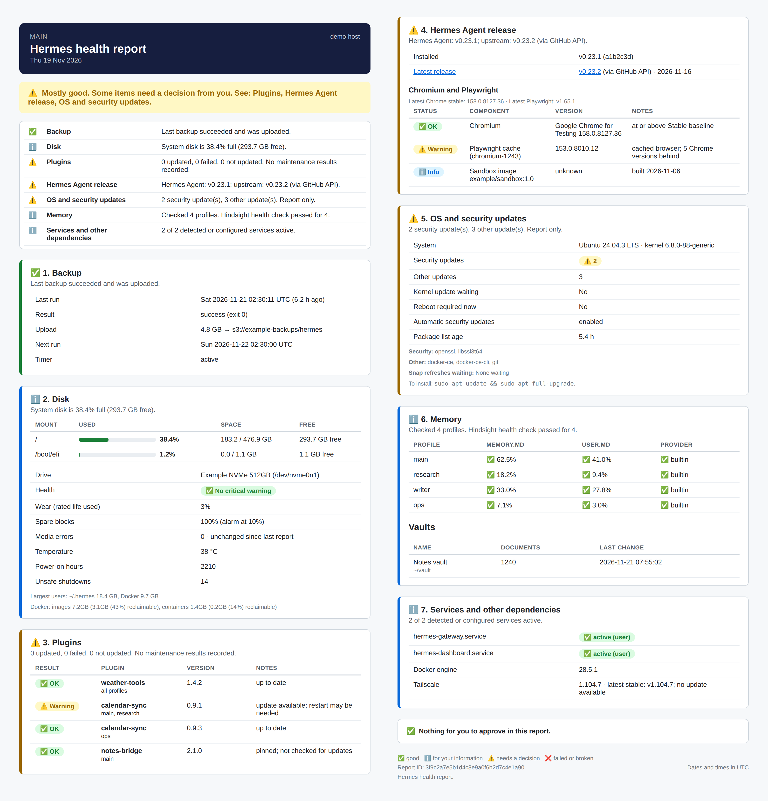

# hermes-health-report

A Hermes Agent instance runs unattended for most of the week. Backups can fail, disks fill, plugins drift behind their upstreams and security updates wait, and none of that is visible until something breaks. Checking it by hand means logging in and running the same commands each time.

## Purpose

This plugin collects health facts from the host and from every Hermes profile it can see, and writes them as one HTML report. It can send through Microsoft Graph, SMTP or a Hermes send target, or write a local HTML file. Network delivery is off until you turn it on.

Microsoft Graph uses Hermes public plugin OAuth; the legacy token helper is no longer loaded. Hermes buffers each full response in memory before the plugin checks its 1 MiB response and 4 MiB total conversation-page limits. A limit violation fails closed, but these limits are not network or peak-memory bounds.

Scheduling and maintenance are also opt-in. Nothing runs on a timer until you create the jobs and enable them in the config.

> [!WARNING]
> **Preview.** This is version 0.1.1, an early preview. Expect breaking changes. Issues and pull requests are welcome.

## What the report looks like

A sample report, split in two and shown side by side. All data in it is invented.



## Requirements

- Linux with systemd. The collectors use `systemctl`, `journalctl` and APT, and they report a partial result when a tool is missing.
- Hermes Agent 0.23.2 or later.
- Optional: authenticated SMTP needs a mail account and `EMAIL_PASSWORD` in the active Hermes secret scope.
- Optional: release lookups use `GITHUB_TOKEN` from the active Hermes secret scope. Without it, the plugin uses the public GitHub API. It does not use a GitHub CLI sign-in.

Each missing collector tool degrades one part of the report. It does not stop the rest.

## How it works

`hermes health-report report` collects seven sections and renders one self-contained HTML page:

1. **Backup.** The configured user service, its timer, the last result and exit status, the size of the last verified upload found in the journal, and the next run.
2. **Disk.** Mount usage in GB, NVMe SMART data including wear, spare blocks, media errors and temperature, and the sizes of the largest local directories and Docker usage. Media error counts are compared with the previous report.
3. **Plugins.** One row per directory-installed plugin in each profile, with the installed version and whether Hermes reports an update. Linked and pinned installs are reported as not managed or not checked. The latest recorded maintenance result is included when one exists.
4. **Hermes Agent release.** Installed version against the latest upstream release, the effective Chromium build and where it came from, Playwright caches and sandbox images, each compared with the Chrome for Testing Stable baseline where possible.
5. **OS and security updates.** APT security and other update counts as separate lists, whether a kernel update or a reboot is waiting, the age of the package lists, unattended-upgrades status and any Snap refreshes waiting. Report only.
6. **Memory.** For each profile, `MEMORY.md` and `USER.md` sizes against their character limits, and the memory provider. When a Hindsight endpoint is configured, its `/health` result. Configured vaults are listed with document counts and the newest modification time. Memory file contents are never read into the report.
7. **Services and other dependencies.** Configured systemd units, or detected Hermes gateway and Desktop backend units when none are configured, plus any `cloudflared` units found. The report also records Docker, `cloudflared` and Tailscale versions against their upstreams. Tailscale is reported with a note that a restart can interrupt remote access.

Every collector runs even when another one fails. A collector that throws returns a warning row for its section, so a missing dependency gives you a partial report with the gap marked, rather than no report at all.

The `--kind maintenance` variant collects the same sections and marks the report as a maintenance report, so the Plugins section can show the results recorded by the last maintenance run. It offers no actions.

## Delivery

A dry run runs the collectors and writes a private HTML preview. It does not send mail, create an approval offer or run maintenance.

A live run tries delivery in this order:

1. **Microsoft Graph.** Delegated mail through the signed-in profile; only this channel can offer actions.
2. **SMTP.** Sends mail to the configured recipients over TLS. Authenticated SMTP requires Hermes to supply `EMAIL_PASSWORD` to the caller. Hermes can strip credentials from no-agent cron scripts. If the password is unavailable, the report skips SMTP and uses the next configured channel.
3. **Profile.** A `hermes send` target, given the report text on standard input.
4. **Local.** A private HTML file in the profile report directory.

Vault paths appear only in the email version. The local file and the default preview omit them, and `--preview-email` produces the email version as a private preview.

If a send result is uncertain, the plugin stops. It records the report ID in `delivery-pending.json` and does not try a fallback, because a fallback could send the report twice. Check Sent Items or the provider, and clear that file only when you know what happened.

## Approvals in brief

Approvals default to off. SMTP, profile and local reports do not offer actions. Before enabling Graph approvals, a mail administrator must verify owner authentication across every delivery path; matching addresses and headers do not prove identity. Before upgrading, resolve existing offers and maintenance cards, and check for any restart timer already queued. See the [approval rules](docs/approvals.md).

## Settings

Settings live in `hermes-health-report/config.yaml` inside the selected profile directory. No credentials belong in this file. Configure `EMAIL_PASSWORD` and `GITHUB_TOKEN` through Hermes on the report profile.

| Setting | Meaning |
|---|---|
| `instance_name` | Name shown at the top of the report. Defaults to the Hermes Unix user. |
| `sender` | Mailbox address that sends reports. |
| `recipients` | List of addresses that receive reports. |
| `owners` | List of addresses allowed to approve actions by reply. |
| `scheduler`, `maintenance`, `approvals` | Master switches for the scheduled jobs, the maintenance job and reply approvals. All default to off. |
| `delivery.graph`, `delivery.smtp`, `delivery.profile` | Enable each delivery channel. All default to off. Legacy settings cannot enable Graph. |
| `smtp.host`, `smtp.port`, `smtp.security`, `smtp.username` | SMTP server. `security` is `ssl` or `starttls`. The password is `EMAIL_PASSWORD` from Hermes. |
| `profile.target`, `profile.command` | `hermes send` destination and, if needed, the Hermes executable. |
| `backup_unit`, `backup_target` | Backup user service to check, and a label for where backups go. No backup service is checked by default. |
| `services` | Extra systemd units to check. |
| `dashboard_url` | Hermes dashboard link shown in Services. The link is listed, not checked. |
| `disk_mounts` | Mounts to report. Defaults to `/`, plus `/boot/efi` when mounted. |
| `disk_size_paths` | Directory paths to measure and show in Disk usage details. No directories are measured by default. |
| `vaults` | List of `{name, path}` document vaults to count and date. |
| `hindsight.web_url`, `hindsight.api_url` | Memory console link and API base. The report checks `/health` on the API base and never prints that URL. |
| `probes` | List of `{name, argv}` read-only commands. The report shows pass or fail only, never the output. |
| `kanban_board`, `maintenance_profile` | Board for approval cards, and the profile assigned to them. |
| `update_plugins` | Exact plugin names an approval may update on the report profile. |
| `restart_unit`, `restart_downtime_minutes` | One Hermes user service an approval may restart after the card completes, and the downtime shown in the email. |

## Scheduled jobs

`hermes health-report setup` writes small wrapper scripts into the profile `scripts` directory and creates or updates three named cron jobs:

- `hermes-health-report:scheduled-maintenance` at 07:30 on Saturday. This job runs the allowlisted plugin update with an agent.
- `hermes-health-report:report` at 08:30 on Saturday, no agent.
- `hermes-health-report:poll` every 15 minutes, no agent. This job checks for approval replies.

Jobs use the profile time zone. All jobs require `scheduler: true`. Scheduled maintenance also requires `maintenance: true`. The poll job also requires `approvals: true`; leave it off unless the administrator has verified owner authentication. Setup refuses to overwrite an unrelated wrapper or reuse a job name that points elsewhere. Turn the switches off and run setup again to pause the jobs.

## What the plugin accesses

- **Commands:** Collectors run `systemctl`, `journalctl`, `smartctl`, `udisksctl`, `gdbus`, `du`, `docker`, `git`, `apt-get -s`, `snap refresh --list` and version commands for Chromium, `cloudflared` and Tailscale. Python child processes check plugin updates and Chromium. Configured `probes[].argv` run as the report user, including during dry runs. Use trusted read-only commands. Optional delivery runs `hermes send`. Optional maintenance runs `hermes plugins update` for other allowlisted plugins, never for itself. An existing authorised restart can invoke `systemd-run --user` with `systemctl --user restart`.
- **Network:** Collectors query the GitHub releases API and Chrome for Testing. Hermes plugin update checks may contact configured feeds and upstream repositories. Optional delivery sends report data to Microsoft Graph, the configured SMTP server or Hermes destination. Graph approval polling reads mailbox replies; OAuth contacts Microsoft identity endpoints. There is no telemetry.
  - **Hindsight:** The report checks `/health` for profiles with `memory.provider: hindsight`. This check runs during scheduled reports and dry runs too. It uses the first JSON object found in the profile's `hindsight/config.json` or `~/.hindsight/config.json`, in that order.
    - If `api_url` is non-empty, it takes precedence. The check needs an HTTP(S) URL.
    - Without `api_url`, modes `local_embedded` and `local_external` use `http://localhost:8888/health`. Any other mode or no mode uses the public fallback, `https://api.hindsight.vectorize.io/health`, even without explicit cloud configuration.
    - If `.env` was the only source of an endpoint override, an upgrade can change the destination. The report no longer reads that override.
  - If the report settings specify `hindsight.api_url`, the report also checks that endpoint's `/health` path. The Hindsight health checks send no memory content.
- **Files outside plugin data:** Collectors inspect host mount and disk metadata, OS and APT metadata, the configured backup service journal, Hermes source and Git metadata, profile configuration and plugin manifests, browser caches, Hindsight configuration, and vault filenames and timestamps. They read `MEMORY.md` and `USER.md` only to count characters. Setup writes wrappers into the profile `scripts` directory and updates the cron store. Approval processing reads Kanban board and task state.
- **Background work and credentials:** Setup registers the jobs above. The completion hook can schedule a one-shot restart for an authorised card. The plugin does not start its own daemon or store credentials. It reads its declared secrets through Hermes, not from credential files; Hermes stores and refreshes the Graph OAuth grant in the active profile.

**Remaining internal Hermes interfaces (rule 9):** The plugin does not patch Hermes core.

| Interface | Why it remains |
| --- | --- |
| `cron.jobs` | Setup checks which script owns a scheduled job before changing it. The cron CLI does not provide a structured listing with script ownership. |
| `hermes_cli.kanban_db` | Legacy approval processing holds a live claim check across the approval transaction. The Kanban CLI cannot hold that check across the transaction. |
| `hermes_cli.plugins_updates` | A child process uses Hermes' install provenance and update checks without writing profile state. On Hermes 0.23.2, `hermes plugins check-updates --json` also writes `plugin-update-checks/results.json` in the checked profile. |
| `hermes_cli.browser_runtime.chromium_executable()` | A child process uses the same read-only selector as Hermes to resolve Chromium, including managed config overlays. `hermes doctor` shows the path in human-readable output but does not offer a structured selector. The report no longer calls private helpers to classify the selection. |

## Install and verify

Start on a test profile. Install an exact commit and enable the plugin on that profile:

```sh
hermes -p example-lab plugins install <repository-url> --ref <full-commit-sha> --enable
hermes -p example-lab plugins doctor --ci hermes-health-report
hermes -p example-lab health-report status
hermes -p example-lab health-report report --dry-run
hermes -p example-lab health-report report --kind maintenance --dry-run
```

The command prints the preview path. Check the preview, then work through the [setup guide](docs/setup.md).

Hermes installs the plugin's declared PyYAML dependency. You do not need to install PyYAML separately to use the plugin.

Run the tests from the repository root:

```sh
python -m pip install PyYAML pytest
python -m pytest -q
```

## Documentation

- [Setup guide](docs/setup.md)
- [Actions and approval rules](docs/approvals.md)
- [Architecture](docs/architecture.md)
- [Design](docs/design.md)
- [Changelog](CHANGELOG.md)

## License

MIT. See [LICENSE](LICENSE).
