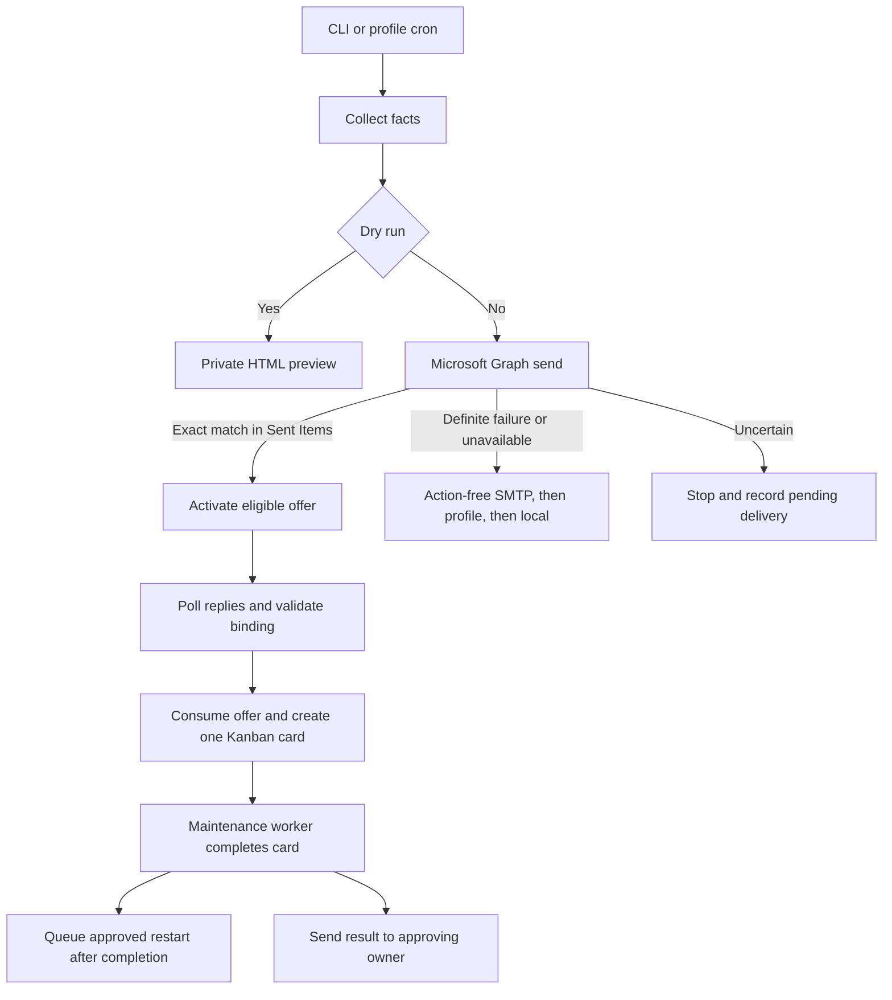

# Architecture

The command-line entry point loads settings from the selected profile, in `hermes-health-report/config.yaml` under the profile directory. State lives in that same directory: previews and local reports, `delivery-pending.json`, `approvals.sqlite3`, `maintenance-latest.json` and the NVMe media error history. No credentials are stored there.

## Collection and rendering

Each collector returns rows for one report section, and every collector runs inside its own error boundary. A missing tool or a failed check produces a warning row for that section and the rest of the report continues.

Collectors are read-only. They call system tools such as `systemctl`, `journalctl`, `smartctl`, `apt-get` in simulation mode, `docker` and `tailscale`, and they call GitHub for release tags. Configured probes run a caller-supplied `argv` list and report only the exit result.

The renderer builds one self-contained HTML page. It escapes every collected value, shows a summary headline for each section above its details, and shows vault paths only in the email version. The local file and the default preview use the version without vault paths.

## Delivery

A live report run takes an exclusive lock and writes `delivery-pending.json` before the first send attempt, so a crash cannot lead to a second send of the same report. Microsoft Graph delivery tags the subject with the report ID and then looks for that exact subject in Sent Items. Only an exact, single match from the configured sender activates an approval offer.

Delivery falls back to SMTP, then to a Hermes send target, then to a local file. Fallback happens only when the earlier channel failed in a way that proves the message was not accepted, or when the channel is unavailable. An uncertain result stops the run with the pending file left in place. Fallback copies carry no approval offer.

## Approvals

The approval store is a SQLite database in the profile report directory. A row binds a report ID to the mailbox, the sent message ID and the conversation ID, plus the offered actions and a snapshot of the maintenance plan. A unique index keeps at most one active offer per mailbox and conversation, and activating a new offer supersedes the older one.

The poll job re-reads the stored sent message from Microsoft Graph before it trusts any reply. It accepts replies only from configured owners, only in the same conversation, only as direct replies to the stored message, and only within 72 hours of the sent time. The parser takes one line of the form `approved` or `approved` followed by action numbers, and ignores quoted history below it.

Consuming an offer and creating its Kanban card cannot be one transaction, because the board is a separate database. The card uses an idempotency key derived from the report ID, and the offer row is marked consumed under an immediate transaction. A process that stops between the two steps cannot create a second card when the poll runs again.

The Kanban completion hook looks for a completed card that matches a consumed offer. It schedules an approved restart through `systemd-run` for two minutes after completion, and it does nothing late if that window has passed. The hook does not send mail. The poll job sends the result email to the approving owner and records the delivery state.

## Jobs

Report and poll jobs run without a model. The optional maintenance job uses the profile agent to run the allowlisted plugin update and read its summary. Scheduled maintenance and card-driven updates share the same code path, and both write `maintenance-latest.json`, which the next report reads for its Plugins section.
